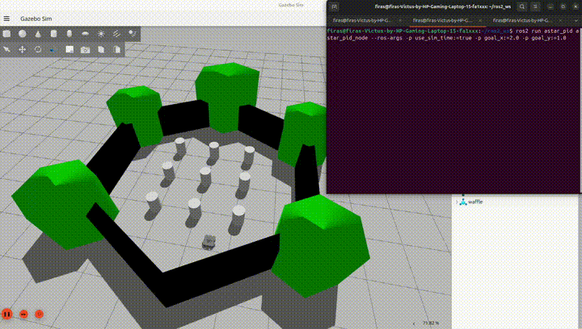

# astar_pid: autonomous exploration and A* + PID navigation (ROS 2 Jazzy)

A TurtleBot3 explores an unknown environment on its own, builds a map with
slam_toolbox, and can search for a goal while exploring. No teleop, no RViz
clicks, and no Nav2: the node only uses slam_toolbox, the lidar and TF.



## Features
- **Frontier-based exploration**: finds the nearest reachable frontier, plans
  with A*, drives with PID, and repeats until the map is complete.
- **Goal search**: if a goal is given, the robot plans directly when the goal is
  on the known map. If not, it explores toward the goal by choosing the frontier
  that minimizes distance travelled plus distance to the goal.
- **Live lidar sensing**: each scan is added to the planning grid immediately,
  without waiting for the next SLAM map update. If a new obstacle blocks the
  path, the robot replans.
- **Reactive safety**: it slows down in front of obstacles, stops when they are
  too close, rotates toward the freer side, and replans.
- **Stuck detection**: if the robot barely moves for 12 s, it drops the target
  and replans.
- Uses `TwistStamped` commands (required by TurtleBot3 on ROS 2 Jazzy).

## Requirements
ROS 2 Jazzy, Gazebo, TurtleBot3 simulation packages, slam_toolbox, numpy.

## Build
```bash
cd ~/ros2_ws/src
git clone https://github.com/firaslouhichi789-sudo/astar_pid.git
cd ~/ros2_ws
colcon build --packages-select astar_pid
source install/setup.bash
```

## Run
```bash
# Terminal 1: simulation
export TURTLEBOT3_MODEL=waffle
ros2 launch turtlebot3_gazebo turtlebot3_world.launch.py

# Terminal 2: SLAM (must keep running)
ros2 launch slam_toolbox online_async_launch.py use_sim_time:=true

# Terminal 3: pure exploration
ros2 run astar_pid astar_pid_node --ros-args -p use_sim_time:=true
```

To search for a goal while exploring (the goal is in the map frame, in metres;
the origin is the robot spawn point):
```bash
ros2 run astar_pid astar_pid_node --ros-args -p use_sim_time:=true \
  -p goal_x:=2.0 -p goal_y:=1.0
```

You can also send a goal while the node is running:
```bash
ros2 topic pub --once /goal_pose geometry_msgs/msg/PoseStamped \
  "{header: {frame_id: map}, pose: {position: {x: 1.5, y: 0.5}}}"
```

The node stops with one of these messages: `Exploration terminée`,
`Objectif atteint` (goal reached), or `Objectif inaccessible` (the reachable
area is fully explored and the goal was not found).

## Parameters
| Parameter | Default | Description |
|---|---|---|
| `goal_x`, `goal_y` | NaN | Goal in the map frame (none = pure exploration) |
| `inflation_radius` | 0.25 | Obstacle inflation (m) |
| `v_max` | 0.18 | Max linear speed (m/s) |
| `goal_tolerance` | 0.15 | Distance to count the goal as reached (m) |
| `stop_dist` | 0.22 | Emergency stop distance in front (m) |
| `slow_dist` | 0.55 | Slow-down distance in front (m) |
| `dyn_range` | 2.0 | Lidar range used for live obstacles (m) |
| `explore` | true | Explore when there is no goal |
| `stamped` | true | `TwistStamped` (Jazzy) or `Twist` |

## Limitations
Tested in simulation only (TurtleBot3 waffle in Gazebo, ROS 2 Jazzy), in a
static world. Reactive avoidance is basic (stop, rotate, replan). There is no
local planner such as DWA yet, so moving obstacles are not handled well.

## License
MIT
